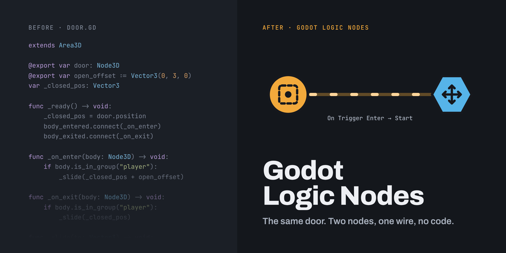

# Godot Logic Nodes

A free visual scripting addon for Godot 4 that lets developers build gameplay without writing code. Place Logic Nodes in your level and wire them together.

**[Read the documentation →](https://jepalmer2.github.io/godot-logic-nodes/guide/)**

> **Status:** v1.0, the first feature-complete release. Requires Godot 4.7+ (standard GDScript build) and a 3D scene.

## Install

1. Copy `addons/godot_logic_nodes/` into your project's `addons/` folder.
2. Enable **Godot Logic Nodes** in **Project > Project Settings > Plugins**.

A **Logic I/O** tab appears in the bottom panel, and Logic Nodes appear in **Add Child Node** (search "Logic"). The plugin also adds its `gln_` input actions to the Input Map.

## Your first door

1. Add a **LogicMove** node and put your door under it. Set **Move Offset** to where the door should slide.
2. Add a **LogicTrigger** in front of the door.
3. Select the trigger and, in the **Logic I/O** panel, add two rows:

| My Output | Target | Target Input |
|---|---|---|
| On Trigger Enter | the Move node | Go To End |
| On Trigger Exit | the Move node | Go To Start |

4. Make sure your player is a physics body in the `gln_player` group, then press play.

Full walkthrough: [Getting started](https://jepalmer2.github.io/godot-logic-nodes/guide/getting-started.html).

## The nodes

| Family | Nodes |
|---|---|
| **Triggers** | [Trigger Volume](https://jepalmer2.github.io/godot-logic-nodes/guide/nodes.html#logictrigger), [Interact Zone](https://jepalmer2.github.io/godot-logic-nodes/guide/nodes.html#logicinteract) |
| **Movers** | [Move](https://jepalmer2.github.io/godot-logic-nodes/guide/nodes.html#logicmove), [Rotate](https://jepalmer2.github.io/godot-logic-nodes/guide/nodes.html#logicrotate) |
| **Logic** | [Auto](https://jepalmer2.github.io/godot-logic-nodes/guide/nodes.html#logicauto), [Relay](https://jepalmer2.github.io/godot-logic-nodes/guide/nodes.html#logicrelay), [Timer](https://jepalmer2.github.io/godot-logic-nodes/guide/nodes.html#logictimer), [Counter](https://jepalmer2.github.io/godot-logic-nodes/guide/nodes.html#logiccounter), [Branch](https://jepalmer2.github.io/godot-logic-nodes/guide/nodes.html#logicbranch) |
| **Feedback** | [Audio Clip](https://jepalmer2.github.io/godot-logic-nodes/guide/nodes.html#logicaudioclip), [Debug](https://jepalmer2.github.io/godot-logic-nodes/guide/nodes.html#logicdebug) |

Every input, output and setting is in the [Node reference](https://jepalmer2.github.io/godot-logic-nodes/guide/nodes.html). Ready-made setups (elevators, timed doors, puzzles) are in [Recipes](https://jepalmer2.github.io/godot-logic-nodes/guide/recipes.html).

## Demo scenes

Open `addons/godot_logic_nodes/scenes/Sandbox.tscn` for a labeled example of every node plus working doors, an elevator and a puzzle gate.

## Credits and license

Created by Justin Palmer for ITGM-748 at the Savannah College of Art and Design, with development assistance from Claude (Anthropic). Interface sounds by [Kenney](https://kenney.nl) (CC0).

MIT. See [LICENSE](LICENSE). Known limitations are listed in [the docs](https://jepalmer2.github.io/godot-logic-nodes/guide/about.html).
